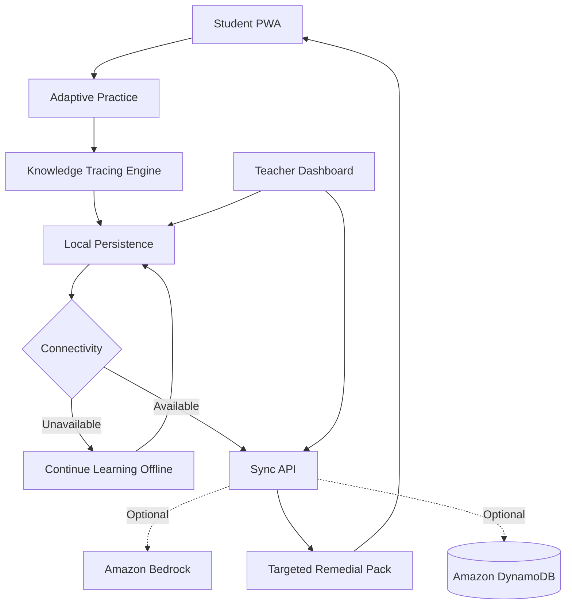

<div align="center">

# ShikshaSync
### Offline-first adaptive learning for multi-grade classrooms

**Learn without interruption. Adapt to every learner. Sync when connected.**

<p>
  <a href="#overview">Overview</a> ·
  <a href="#key-capabilities">Capabilities</a> ·
  <a href="#system-architecture">Architecture</a> ·
  <a href="#quick-start">Quick Start</a> ·
  <a href="#demo-workflow">Demo</a>
</p>


</div>

---

<a id="overview"></a>
## Overview

ShikshaSync is an **offline-first adaptive learning Progressive Web App (PWA)** built for rural and resource-constrained classrooms—especially multi-grade environments where one teacher may support students across Grades 3–5.

It brings together personalized practice, multilingual learning support, local-first data persistence, and lightweight synchronization so that learning can continue even when connectivity is unreliable.

> **Design principle:** Connectivity should enhance learning—not determine whether learning can happen.

### The challenge

- **Multi-grade teaching:** A single teacher may need to support learners at different levels simultaneously.
- **Uneven connectivity:** Cloud-dependent experiences can become unavailable when the network drops.
- **Individual learning needs:** Students require practice that responds to their demonstrated understanding.
- **Language accessibility:** Learning support should be available in languages students are comfortable with.

### Our approach

| Challenge | ShikshaSync approach |
|---|---|
| Connectivity interruptions | Local-first learning and offline PWA support |
| Different learning levels | Bayesian Knowledge Tracing-based mastery updates |
| Language accessibility | English, Kannada and Hindi support |
| Limited sync windows | Lightweight learning deltas and remedial packs |
| Teacher visibility | Grade-level mastery dashboard |

---

<a id="key-capabilities"></a>
## Key Capabilities

<details open>
<summary><strong>Adaptive practice · Bayesian Knowledge Tracing</strong></summary>

The learning engine updates estimated student mastery as questions are answered and adapts practice difficulty.

- Tracks Mathematics and Reading mastery.
- Mastery score range: `0.05–0.99`.
- Practice difficulty levels: `1–3`.
- Supports adaptive learning while offline.

**Implementation:** `lib/bkt.ts`

</details>

<details>
<summary><strong>Multilingual learning & voice hints</strong></summary>

Students can use learning support in:

- English
- Kannada
- Hindi

Text-to-speech uses the `/api/tts` route with ElevenLabs when configured. Browser `speechSynthesis` is available as an offline fallback. Audio can be cached through the browser Cache API.

</details>

<details>
<summary><strong>Offline-first Progressive Web App</strong></summary>

The app is designed to retain its core learning experience during connectivity loss.

- Service worker precaches core routes.
- Cache API supports cached audio.
- `localStorage` is mirrored to IndexedDB.
- Mastery state, remedial packs and pending sync deltas persist locally.

**Implementation:** `public/sw.js`, `lib/storage.ts`

</details>

<details>
<summary><strong>Low-bandwidth synchronization</strong></summary>

When connectivity is available, learning deltas can be synchronized and targeted remedial content returned.

- Endpoint: `POST /api/sync`
- Designed for small sync windows (under 500 KB).
- Targeted remedial response designed to be lightweight (~1–2 KB).
- Optional AWS DynamoDB and Amazon Bedrock integration.
- Deterministic local fallback when cloud services are unavailable or unconfigured.

</details>

<details>
<summary><strong>Teacher dashboard</strong></summary>

A classroom overview for monitoring student progress and identifying learners who may need additional support.

| Learning status | Mastery threshold |
|---|---:|
| Needs help | Below 45% |
| Practicing | 45–69% |
| Mastered | 70% and above |

Dashboard features include grade averages, mastery matrix, sync queue visibility, latest remedial pack, sync controls and demo reset.

</details>

---

<a id="system-architecture"></a>
## System Architecture



### Data flow

1. A student completes a practice activity.
2. The knowledge-tracing engine updates mastery estimates.
3. Learning state is persisted locally.
4. If offline, the learning session continues and sync deltas remain queued.
5. When online, the client sends pending deltas to the sync API.
6. The API returns a remedial pack, using cloud integration when configured or a local fallback otherwise.

---

<a id="application-routes"></a>
## Application Routes

| Route | Description |
|---|---|
| `/` | Student selection, language selection, mastery overview and queue status |
| `/learn/[id]` | Adaptive practice, Math/Reading focus, mastery indicators, hints and remedial drills |
| `/teacher` | Mastery matrix, grade averages, sync queue, remedial pack and demo reset |
| `/api/tts` | Voice synthesis; fallback response when unavailable |
| `/api/sync` | Learning-delta synchronization and remedial-pack response |

<details>
<summary><strong>Demo student profiles</strong></summary>

The demo includes student profiles for Aarav, Kavya, Rohan and Meera across Grades 3–5.

</details>

---

<a id="quick-start"></a>
## Quick Start

### Prerequisites

- Node.js
- npm
- A modern browser

### 1 · Clone the repository

```bash
git clone <your-repository-url>
cd shikshasync
```

### 2 · Install dependencies

```bash
npm install
```

### 3 · Start the development server

```bash
npm run dev
```

### 4 · Open the app

Visit **[http://localhost:3000](http://localhost:3000)**.

### Production build

```bash
npm run build
npm run start
```

---

<a id="configuration"></a>
## Configuration

Cloud services are optional. To configure them locally, copy the example environment file:

```bash
cp .env.example .env.local
```

| Environment variable | Purpose | Default |
|---|---|---|
| `ELEVENLABS_API_KEY` | Enables ElevenLabs TTS | — |
| `ELEVENLABS_VOICE_ID` | Optional voice selection | — |
| `AWS_REGION` | AWS region | `ap-south-1` |
| `AWS_ACCESS_KEY_ID` | AWS authentication | — |
| `AWS_SECRET_ACCESS_KEY` | AWS authentication | — |
| `AWS_DYNAMODB_TABLE` | DynamoDB table | — |
| `AWS_BEDROCK_MODEL_ID` | Bedrock model ID | `amazon.nova-micro-v1:0` |

<details>
<summary><strong>Security note</strong></summary>

Keep secrets in `.env.local` or your deployment platform's secret manager. Never commit API keys, access keys or other credentials to version control.

</details>

---

<a id="demo-workflow"></a>
## Demo Workflow

<details open>
<summary><strong>Run the two-minute walkthrough</strong></summary>

| Step | Action | What to demonstrate |
|---:|---|---|
| 1 | Select a student | Choose a learner, e.g. Aarav (Grade 3) |
| 2 | Enable Offline Mode | Show that the learning flow is not dependent on a live connection |
| 3 | Select a language | Switch between English, Kannada and Hindi |
| 4 | Use Listen | Demonstrate voice hints and fallback behavior |
| 5 | Answer questions | Show mastery updates and adaptive practice |
| 6 | Open `/teacher` | Present the mastery matrix and grade averages |
| 7 | Switch online & Sync now | Demonstrate pending data synchronization |
| 8 | Review remedial pack | Show targeted remediation returned by sync |
| 9 | Reset demo | Restore the demo experience |

</details>

---

<a id="technology-stack"></a>
## Technology Stack

| Layer | Technology |
|---|---|
| Framework | Next.js 16 App Router |
| UI | React 19 |
| Language | TypeScript |
| Styling | Tailwind CSS v4 |
| Development | Turbopack |
| PWA | Service Worker, Web App Manifest |
| Local persistence | localStorage, IndexedDB, Cache API |
| Adaptivity | Bayesian Knowledge Tracing |
| Voice | ElevenLabs, Web Speech API fallback |
| Optional cloud | AWS DynamoDB, Amazon Bedrock |
| Cloud authentication | AWS Signature Version 4 |

---

## Scripts

| Command | Description |
|---|---|
| `npm run dev` | Start local development |
| `npm run build` | Build the production app |
| `npm run start` | Start production server |
| `npm run lint` | Run ESLint |

---

## Project Structure

```text
shikshasync/
├── app/
│   ├── api/
│   │   ├── sync/
│   │   └── tts/
│   ├── learn/
│   └── teacher/
├── lib/
│   ├── bkt.ts
│   └── storage.ts
├── public/
│   ├── sw.js
│   └── manifest.*
├── .env.example
├── package.json
└── README.md
```

---

## Project Vision

ShikshaSync explores how adaptive learning can remain useful in classrooms where connectivity, language and limited teaching capacity are real constraints.

**Learning should be resilient, personalized and accessible—even offline.**

<div align="center">

**ShikshaSync**  
*Learn anywhere. Improve continuously.*

</div>
